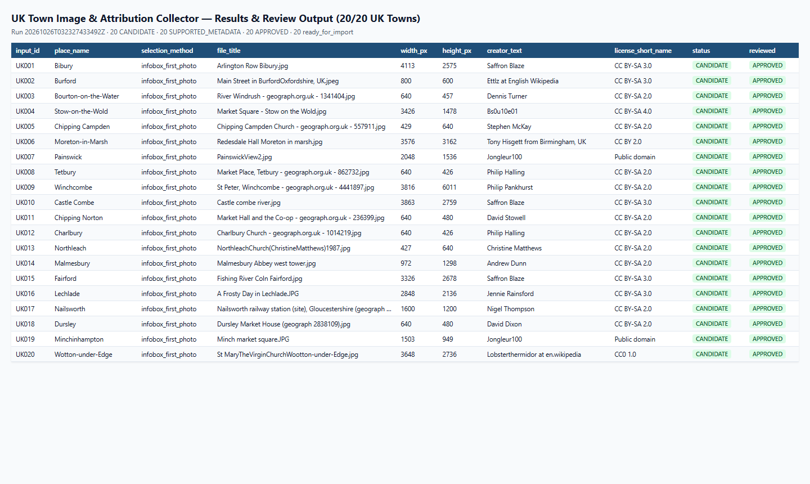

# Case Study — UK Town Image & Attribution Collector

> **Independent portfolio project inspired by a public freelance brief.**
> Reference brief: [Freelancer Project #38882143 — Wiki Page Image Scraper](https://www.freelancer.ca/projects/web-scraping/wiki-page-image-scraper). No client engagement, endorsement, or contract with the original poster is claimed.

## 1. Problem & Workflow Context

A content manager building a UK town guide needs one representative photograph per town from English Wikipedia, together with the original Wikimedia Commons file URL, image dimensions, creator credit, license link, and a ready-to-paste attribution line. Doing this manually across dozens of articles means opening each Wikipedia page, skipping locator maps and coats of arms in the infobox, following the `File:` link to Wikimedia Commons, separating the actual photographer from the file uploader, checking whether the license is reusable, and copying everything into a spreadsheet.

## 2. Solution & Engineering Design

`uk-town-image-collector` is a bounded, review-first Python CLI tool that turns a 20-row `input.csv` (`input_id,place_name,wikipedia_url`) into an auditable review package:

1. **Strict pre-request validation (`validation.py`):** Verifies exact headers, unique `input_id`s, non-blank place names, and canonical `https://en.wikipedia.org/wiki/<Article>` URLs (rejecting credentials, query strings, non-article namespaces, and foreign hosts before any network call).
2. **Respectful Wikimedia transport (`robots.py`, `transport.py`):** Checks live `robots.txt`, sends a descriptive `User-Agent` with the operator's public contact URL, paces requests sequentially (`>= 1.0 s` between uncached requests, `20 s` timeout, max 2 retries on network/`5xx`), and stops the batch immediately on HTTP `401/403/429` or `Retry-After`.
3. **DOM-order infobox discovery + fallbacks (`parsers.py`, `mediawiki_api.py`):**
   - Selects the first infobox photograph (`selection_method=infobox_first_photo`) while filtering out locator maps, flags, coats of arms, logos, and icons.
   - Strips `<style>`/`<script>` elements so MediaWiki TemplateStyles inside multi-image infoboxes (`{{multiple image}}`, e.g. Nailsworth) never pollute captions, and reads tile-level captions (`div.tsingle`).
   - Falls back to MediaWiki Action API `pageimages` (`pilicense=free`, `selection_method=pageimages_fallback`) or article `og:image` (`selection_method=html_pageimage_fallback`) when an infobox has no suitable photo.
4. **Commons provenance & license verification:**
   - Extracts original file URLs and distinct thumbnail URLs (with `utm_*` tracking parameters stripped), pixel dimensions, and MIME type.
   - Reads creator attribution from `{{Information}}` author fields, explicit file-page copyright notices (`Photograph © Andrew Dunn` on `UK014`), or sanitised Action API `extmetadata` — never from the upload history username.
   - Preserves all license templates in `license_evidence` and deterministically selects a v1-supported license (`CC0 1.0`, `Public domain` with stated basis such as `PD-self`, `CC BY 2.0/3.0/4.0`, `CC BY-SA 2.0/3.0/4.0`).
5. **Human-in-the-loop review binding (`review.py`):**
   - Every decision in `review.csv` is bound to `(input_id, file_title)` and a 16-hex SHA-256 metadata fingerprint. If an article's image or license changes on a later run, old approvals automatically reset to `PENDING`.
   - `ready_for_import.csv` admits only rows that are `CANDIDATE` + `APPROVED` + `SUPPORTED_METADATA` with all required fields complete.
6. **Zero-install Desktop Application (`ui.py`, `start_app.bat`):** For non-technical clients who prefer a standard desktop app over running terminal commands, includes a 1-click launcher (`start_app.bat` or `python app.py`), card-based candidate reviewer, full-image zoom modal with DOM evidence, 1-click attribution copying, interactive human review/license overrides, and instant deliverable exports.

## 3. Measured Live Run Results (26 October 2026)

Run directory: `outputs/20261026T032327433492Z` (also mirrored in `samples/20261026-cotswolds-20/`).

| Metric | Measured value | Notes |
| --- | --- | --- |
| Supplied inputs (`input.csv`) | `20` | 20 UK market towns and villages in the Cotswolds & surrounding counties |
| Unique canonical Wikipedia pages | `20` | `page_id` and `revision_id` captured for all 20 pages |
| Unique Wikimedia Commons files | `20` | 20/20 selected via `infobox_first_photo` after excluding locator maps |
| Extraction coverage (`CANDIDATE`) | `20 / 20` | Every row resolved to a Commons photograph with original + thumbnail URLs |
| Metadata completeness (`SUPPORTED_METADATA`) | `20 / 20` | Creator, credit/source, supported license, dimensions, and SHA-256 evidence |
| Edge cases resolved with provenance flags | `4 / 20` | `UK002` multi-license (`CC BY-SA 3.0` + `GFDL`), `UK007` & `UK019` (`PD-self`), `UK014` (`Photograph © Andrew Dunn`) |
| Human review decisions recorded | `20 / 20 APPROVED` | Each row verified against its Wikipedia article and Commons file page |
| `ready_for_import.csv` rows | `20 / 20` | Complete attribution text and evidence links ready for CMS import |
| Automated contract & fixture test suite | `19 / 19 passing` | Offline unit + integration tests covering redirects, errors, resume, formula escaping, and desktop Web UI/APIs |

## 4. Output Preview

Rendered from `outputs/20261026T032327433492Z/results.xlsx` (also exported via LibreOffice Calc to [`docs/assets/results.pdf`](docs/assets/results.pdf)):

## 5. Boundaries & Honest Framing

- `SUPPORTED_METADATA` means the Commons page states a license within the project's v1 allowlist; it is not legal advice and does not clear trademark, personality, or property rights.
- No original image files are bulk-downloaded in v1; only URLs, dimensions, attribution text, and verifiable field evidence are collected.
